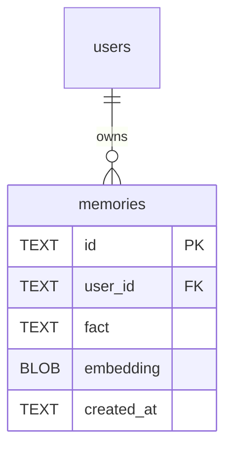

# Data Model: Reflector de Aprendizado e Esquecimento de Preferências

**Feature**: `009-reflector-aprendizado`  
**Date**: 2026-10-30  

## Diagrama Entidade-Relacionamento



A tabela `memories` no SQLite já existe em `SqliteMemoryStore`. Esta feature introduz as estruturas de reflexão e contratos de esquecimento:

---

## 1. Tipos de Aprendizado e Reflexão

```typescript
export interface LearningResult {
  hasLearning: boolean;
  fact?: string;
}

export interface LearningReflector {
  reflect(userMessage: string): Promise<LearningResult>;
  reflectAndRemember(userId: string, userMessage: string): Promise<void>;
}
```

---

## 2. Contrato de Entrada para a Ferramenta `forget_preference`

```typescript
export interface ForgetPreferenceInput {
  memoryId: string;
  userId?: string;
}
```
