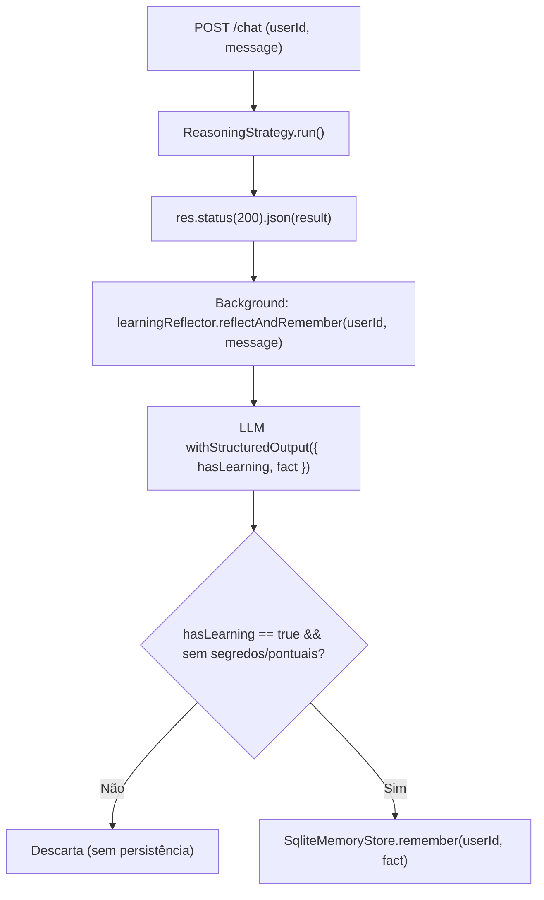

# Implementation Plan: Reflector de Aprendizado e Esquecimento de Preferências

**Feature**: `009-reflector-aprendizado`  
**Date**: 2026-10-30  
**Branch**: `009-reflector-aprendizado`  

## Architecture Overview

Esta feature introduz aprendizado contínuo assíncrono no OpsPilot, destilando fatos duráveis através de `withStructuredOutput` e oferecendo a ferramenta `forget_preference`.

---

## Phases & Deliverables

### Phase 1: Módulo de Reflexão Estruturada (`src/memory/learning-reflector.ts`)
- **Ações**:
  - Definir `learningSchema` Zod com `{ hasLearning: boolean, fact?: string }`.
  - Criar `LearningReflector` interface e implementação `LlmLearningReflector` usando `model.withStructuredOutput(learningSchema)`.
  - Implementar `FakeLearningReflector` para testes determinísticos sem chamada a LLM.
  - Implementar `reflectAndRemember(userId, userMessage)` com tratamento de exceção seguro.
- **Testes**: `src/memory/learning-reflector.test.ts`.

### Phase 2: Ferramenta `forget_preference` (`src/agents/tools.ts`)
- **Ações**:
  - Criar `createForgetPreferenceTool(memoryStore: MemoryStore, currentUserId?: string)` com schema Zod `{ memoryId: string, userId?: string }`.
  - Registrar a ferramenta em `createAgentTools(...)`.
  - Validar isolamento de usuário via `memoryStore.forget(userId, memoryId)`.
- **Testes**: Adicionar casos em `src/agents/tools.test.ts`.

### Phase 3: Integração Assíncrona no Servidor HTTP (`src/http/server.ts`)
- **Ações**:
  - Aceitar `createLearningReflector` opcional em `ServerOptions`.
  - Remover a gravação cega direta `await memoryStore.remember(body.userId, body.message)` que existia anteriormente.
  - Logo após enviar o response `res.status(200).json(...)`, disparar `learningReflector.reflectAndRemember(body.userId, body.message)` em background (não-bloqueante).
- **Testes**: Testes de integração em `src/http/server.test.ts` verificando:
  - Fatos duráveis são gravados em background.
  - Comandos pontuais não geram memória.
  - A resposta HTTP não fica bloqueada esperando a reflexão.

### Phase 4: Validação Final & Gates de Qualidade
- `npm run typecheck`
- `npm test`
