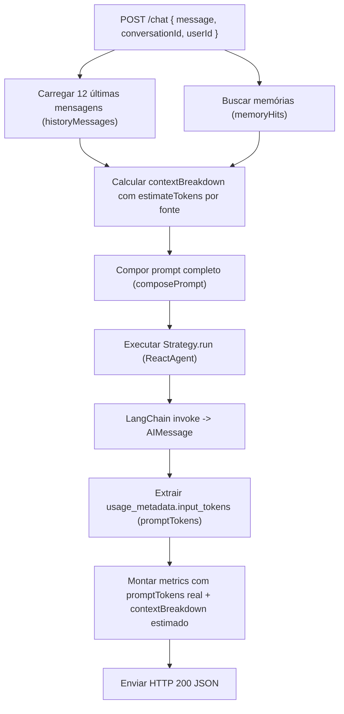

# Data Model: Medição e instrumentação de tokens do contexto

## Entities

### 1. ContextBreakdown (TypeScript Interface & Zod Schema)

Representa a decomposição estimada de tokens nas diferentes fontes que compõem o prompt enviado ao modelo.

```typescript
export interface ContextBreakdown {
  memories: number;
  history: number;
  userMessage: number;
  totalEstimated: number;
}
```

- **Fields**:
  - `memories` (number, não negativo): Tokens estimados calculados sobre os fatos de memória semântica injetados (`MEMORY: <fato>`).
  - `history` (number, não negativo): Tokens estimados calculados sobre as mensagens do histórico da conversa ativa (`USER: ...`, `ASSISTANT: ...`).
  - `userMessage` (number, não negativo): Tokens estimados calculados sobre a mensagem atual do usuário (`USER: ...`).
  - `totalEstimated` (number, não negativo): Estimativa consolidada calculada sobre o prompt final completo composto.
- **Validation Rules**:
  - Todos os valores devem ser inteiros maiores ou iguais a 0.
  - `totalEstimated >= (memories + history + userMessage)` (a composição final pode incluir quebras de linha ou prefixos de formatação).

### 2. TokenUsageMetadata

Representa a captura de uso de tokens extraída de uma resposta ou coleção de mensagens do LangChain.

```typescript
export interface TokenUsageMetadata {
  promptTokens: number;
  completionTokens?: number;
  totalTokens?: number;
}
```

- **Fields**:
  - `promptTokens` (number): Número real de tokens de entrada (`input_tokens`) consumidos nas chamadas ao modelo daquela estratégia.
  - `completionTokens` (number, opcional): Número de tokens gerados na resposta.
  - `totalTokens` (number, opcional): Total de tokens combinados.

### 3. Extended ReasoningMetrics (Update in `src/agents/types.ts`)

```typescript
export interface ReasoningMetrics {
  llCalls: number;
  latencyMs: number;
  historyMessages?: number;
  memoryHits?: number;
  promptTokens?: number;
  contextBreakdown?: ContextBreakdown;
}
```

### 4. Extended ChatResponse (Update in HTTP Contract)

```json
{
  "answer": "O cluster Kubernetes de produção opera na região us-east-1.",
  "trace": [...],
  "conversationId": "c4b14d80-5fc5-4f49-b003-8d697b6fa202",
  "metrics": {
    "llCalls": 1,
    "latencyMs": 420,
    "historyMessages": 4,
    "memoryHits": 1,
    "promptTokens": 182,
    "contextBreakdown": {
      "memories": 48,
      "history": 96,
      "userMessage": 18,
      "totalEstimated": 165
    }
  }
}
```

---

## State & Flow Transitions

### Fluxo de Medição no Ciclo do `/chat`



