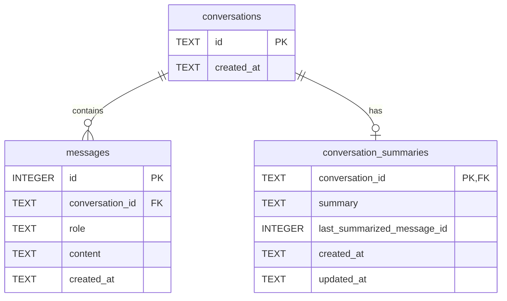

# Data Model: Sumarização de Histórico Conversacional (Pruning)

**Feature**: `011-sumarizacao-historico-pruning`  
**Date**: 2026-10-30  

## Diagrama Entidade-Relacionamento



---

## 1. Esquema SQL

```sql
CREATE TABLE IF NOT EXISTS conversation_summaries (
  conversation_id TEXT PRIMARY KEY REFERENCES conversations(id) ON DELETE CASCADE,
  summary TEXT NOT NULL,
  last_summarized_message_id INTEGER NOT NULL,
  created_at TEXT NOT NULL,
  updated_at TEXT NOT NULL
);

CREATE INDEX IF NOT EXISTS idx_conversation_summaries_last_msg
  ON conversation_summaries (conversation_id, last_summarized_message_id);
```

---

## 2. Tipos e Interfaces TypeScript

```typescript
export interface ConversationSummaryRecord {
  conversationId: string;
  summary: string;
  lastSummarizedMessageId: number;
  createdAt: string;
  updatedAt: string;
}

export interface SummarizeEventPayload {
  conversationId: string;
  previousSummary?: string;
  messagesSummarized: ConversationMessageWithId[];
  newSummary: string;
}

export interface ConversationMessageWithId extends ConversationMessage {
  id: number;
}
```

---

## 3. Operações no Store de Conversa

1. `getSummary(conversationId: string): ConversationSummaryRecord | null`
2. `saveSummary(input: { conversationId: string; summary: string; lastSummarizedMessageId: number }): ConversationSummaryRecord`
3. `getUnsummarizedPrunedMessages(conversationId: string, recentLimit: number): ConversationMessageWithId[]`
   - Retorna as mensagens que têm `id > lastSummarizedMessageId` E que **não estão** entre as últimas `recentLimit` mensagens da conversa.

