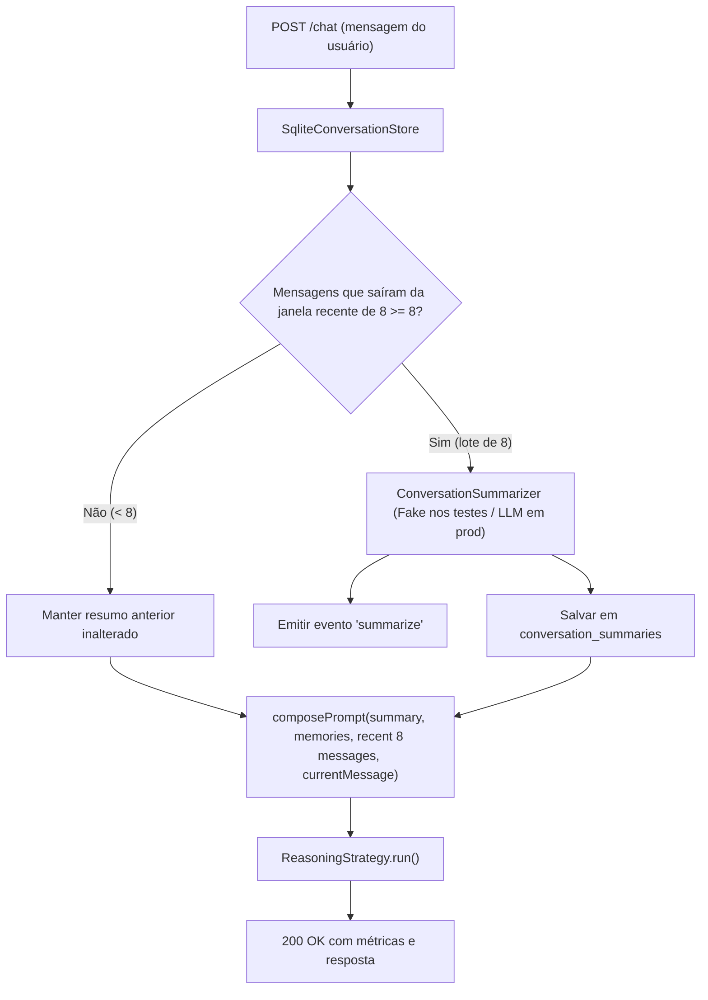

# Implementation Plan: Sumarização de Histórico Conversacional (Pruning)

**Feature**: `011-sumarizacao-historico-pruning`  
**Date**: 2026-10-30  
**Branch**: `011-sumarizacao-historico-pruning`  

## Architecture Overview

O objetivo desta feature é introduzir poda de histórico conversacional (*pruning*) com sumarização em lote, preservando o contexto essencial (decisões, fatos operacionais e pendências) sem inflar a janela de contexto nem incorrer em custos recorrentes a cada turno.

---

## Phases & Deliverables

### Phase 1: Storage Layer & Data Model (Tabela `conversation_summaries`)
- **Arquivos**: `src/store/sqlite-conversation-store.ts`
- **Ações**:
  - Adicionar tabela `conversation_summaries` ao DDL no construtor.
  - Ajustar constante de mensagens recentes padrão para `8` (anteriormente 12).
  - Implementar métodos:
    - `getSummary(conversationId: string): ConversationSummaryRecord | null`
    - `saveSummary(input: { conversationId: string; summary: string; lastSummarizedMessageId: number }): ConversationSummaryRecord`
    - `getUnsummarizedPrunedMessages(conversationId: string, recentLimit: number): ConversationMessageWithId[]`
- **Testes**: Adicionar testes unitários em `src/store/sqlite-conversation-store.test.ts`.

### Phase 2: Serviço de Sumarização & Evento `"summarize"`
- **Arquivos**: `src/conversation/summarizer.ts`, `src/conversation/summarizer.test.ts`
- **Ações**:
  - Definir interfaces `ConversationSummarizer`, `SummarizerInput`, `SummarizeEventPayload`.
  - Implementar `FakeConversationSummarizer` para testes determinísticos.
  - Implementar `LlmConversationSummarizer` para produção com prompt instruindo limite de ~150 tokens e foco em decisões, fatos e pendências.
  - Implementar orquestrador `maybeSummarizeConversation(...)` que avalia se há $\ge 8$ mensagens podadas pendentes, aciona o sumarizador, persiste no banco e emite o evento `"summarize"`.
- **Testes**: Testes unitários cobrindo fusão com resumo anterior, limite de lote e emissão do evento.

### Phase 3: Integração no HTTP Server (`/chat`) & Composição do Contexto
- **Arquivos**: `src/http/server.ts`, `src/http/server.test.ts`
- **Ações**:
  - Aceitar `summarizer` e `eventEmitter` nas opções de `createApp(options?: ServerOptions)`.
  - Antes de montar o prompt, buscar resumo existente e as 8 mensagens recentes.
  - Atualizar `composePrompt(...)` para injetar `SUMMARY: ...` quando presente.
  - Após a resposta (ou no ciclo de transação da conversa), acionar `maybeSummarizeConversation`.
  - Atualizar `calculateContextBreakdown` para contabilizar tokens do resumo se aplicável.
- **Testes**: Testes de integração em `src/http/server.test.ts` simulando conversa de 1 a 24 mensagens e validando:
  - Nenhuma sumarização em $< 16$ mensagens.
  - Disparo de `"summarize"` na 16ª e 24ª mensagens.
  - Presença de `SUMMARY:` no prompt a partir da 17ª mensagem.

### Phase 4: Validação Final & Gates de Qualidade
- Executar suíte completa: `npm test`
- Executar typecheck estrito: `npm run typecheck`

