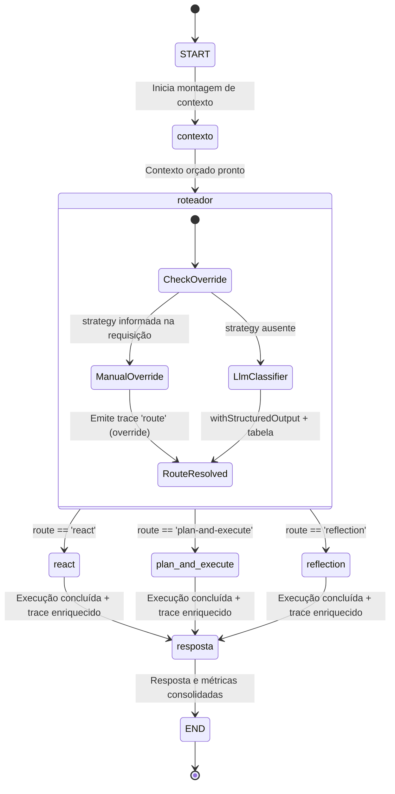

# Data Model: Grafo Unificado de Produção com Roteamento Dinâmico

**Feature**: `013-grafo-unificado-roteamento`  
**Date**: 2026-10-30

## Entities & Interfaces

### 1. `TraceEventType` & `TraceEvent` (Extensão de Observabilidade)

Localização: `src/agents/types.ts`

```typescript
export type TraceEventType =
  | "thought"
  | "action"
  | "observation"
  | "plan"
  | "critique"
  | "answer"
  | "route"; // Novo evento dedicado à decisão do roteador

export interface ActionPayload {
  tool: string;
  args: Record<string, unknown>;
}

export interface TraceEvent {
  type: TraceEventType;
  content: string;
  action?: ActionPayload;
  node: string; // Obrigatório: identificador do nó emissor no grafo
}
```

### 2. `RouterOutput` (Saída Estruturada do Roteador)

Localização: `src/agents/production-graph.ts`

```typescript
import { z } from "zod";

export const ROUTE_NAMES = ["react", "plan-and-execute", "reflection"] as const;
export type RouteName = (typeof ROUTE_NAMES)[number];

export const routerOutputSchema = z.object({
  route: z.enum(ROUTE_NAMES).describe("Estratégia de raciocínio selecionada"),
  reason: z.string().min(1).describe("Justificativa técnica baseada na tabela de critérios"),
});

export type RouterOutput = z.infer<typeof routerOutputSchema>;
```

### 3. `ProductionGraphState` (Estado Central do Grafo)

Localização: `src/agents/production-graph.ts`

```typescript
import type { ConversationMessage } from "../store/sqlite-conversation-store.js";
import type { MemoryRecord } from "../memory/memory-store.js";
import type { BuildContext } from "../context/builder.js";
import type { TraceEvent, ReasoningMetrics } from "./types.js";

export interface ProductionGraphState {
  // Entradas
  message: string;
  conversationId: string;
  userId?: string;
  overrideStrategy?: RouteName;
  maxIterations: number;

  // Contexto construído
  context?: BuildContext;
  historyMessages: ConversationMessage[];
  memories: MemoryRecord[];
  summary: string | null;

  // Decisão de roteamento
  route?: RouteName;
  routeReason?: string;
  isOverride: boolean;

  // Execução e Observabilidade
  trace: TraceEvent[];
  answer?: string;
  metrics: ReasoningMetrics;
}
```

### 4. `ChatRequest` (Contrato de Borda HTTP Atualizado)

Localização: `src/http/server.ts`

```typescript
const requestSchema = z
  .object({
    message: z.string().trim().min(1),
    strategy: z.enum(["react", "plan-and-execute", "reflection"]).optional(),
    reflect: z.boolean().optional().default(false),
    maxIterations: z.number().int().positive().max(32).optional().default(6),
    conversationId: z.string().trim().min(1).optional(),
    userId: z.string().trim().min(1).optional(),
  })
  .strict();
```

---

## State Lifecycle & Transitions



### Regras de Validação e Consistência

1. **Atribuição Universal de Nó (`node`)**:
   - Todo evento adicionado ao `trace` durante o nó `contexto` deve receber `node: "contexto"`.
   - O evento de roteamento deve receber `node: "roteador"`.
   - Eventos das estratégias (`thought`, `action`, `observation`, `plan`, `critique`) recebem `node: <nome_da_estratégia>`.
   - A resposta final consolidada recebe `node: "resposta"`.
2. **Imutabilidade e Acumulação**:
   - O array `trace` utiliza redutor de concatenação (`(left, right) => left.concat(right)`).
   - As métricas de LLM calls e latência são somadas cumulativamente em cada nó.

